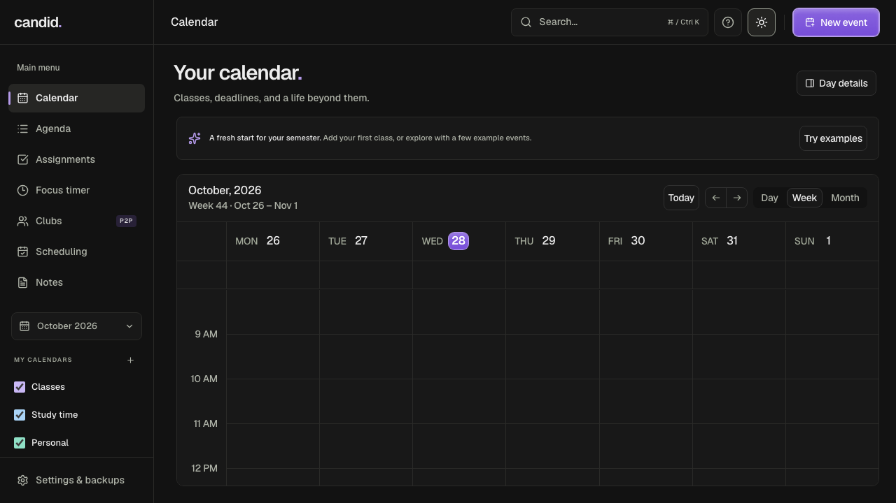

# Candid

A private, local student calendar and study planner, built from the original Kargul calendar design. Includes a Tauri desktop wrapper for macOS and Windows and separate peer-to-peer university club dashboards.

## Downloads

Download the current public preview from [GitHub Releases](https://github.com/webwizarding/candid/releases). See [installation notes](docs/INSTALL.md), [changes](CHANGELOG.md) and [verification limits](VERIFICATION.md). The release uses platform-specific filenames and SHA-256 checksums; preview builds are not notarized or publisher-signed.



## Run locally

```sh
npm ci
npm run dev
```

Open http://localhost:3000. For an optimized local preview:

```sh
npm run build
npm run preview
```

The preview binds only to `127.0.0.1:4173`. Desktop builds embed the static `out/` files and need no Node server or internet connection for planning.

## Desktop builds

Install Node.js, Rust, and [Tauri's platform prerequisites](https://v2.tauri.app/start/prerequisites/). On Windows these include Microsoft C++ Build Tools and WebView2. macOS needs Xcode command-line tools.

```sh
npm run desktop:dev
npm run desktop:build
```

Build on each target OS. For just the macOS app, run `npm run desktop:build -- --bundles app`. Output is in `src-tauri/target/release/bundle/`. Builds are unsigned development artifacts; release signing and notarization are not configured. The app identifier and legacy storage/backup protocol names remain stable across the rename from Calender to Candid.

## Included

- Day, week, month and agenda views. Drag to move/resize events, keyboard alternatives through the event editor, search, undo/redo and an accessible navigation drawer.
- Local course calendars, color labels, weekly classes on selected weekdays through a bounded term end date, overlap warnings, locations and notes. Recurrences are expanded into editable individual dates.
- Assignments with due dates, priority, estimates, completion and edit/delete recovery. “Plan study time” finds an available block of up to 90 minutes before the deadline within the next seven days, between 08:00 and 21:00.
- A persistent focus timer with pause/resume/reset. Countdown uses wall-clock timestamps; completion is checked when the app is running or reopened.
- In-app event reminders while the app is open. These are not background operating-system notifications.
- Local preferences, light/dark appearance, bundled fonts, responsive layouts, reduced-motion support and visible keyboard focus.
- iCalendar (.ics) import/export, review before import, recurring imports over the next year, timezone definitions, and repeat-import matching. ICS times become local wall-clock times. Timezone definitions are required for named timezones; UTC and floating local times also work.
- Full planner backups, optionally password-encrypted with AES-256-GCM and PBKDF2-SHA256 (250,000 iterations, random salt/IV). Imports validate data before merging. Matching personal IDs use the imported values; other items remain. There is no password recovery.
- Local scheduling with meeting templates, availability, buffers, conflict checks, offline guest booking pages, request review and confirmed calendar exports. Club proposals and votes travel through existing peer/file sharing.
- Markdown notes with folders, daily notes, tags, wiki links, backlinks, linked meeting notes, trash recovery and Obsidian-compatible Markdown ZIP interchange. See [scheduling and notes](docs/ACADEMIC_WORKSPACES.md) for setup and limits.

## Canvas and maps

In Canvas, open **Calendar → Calendar Feed** and download the `.ics` file. In Candid, go to **Settings & backups → Connections → Canvas calendar → Import Canvas .ics**. Recognized Canvas assignment deadlines can become tasks; course events go into a separate Canvas calendar. Reimporting preserves task completion and estimates. Canvas controls which events and dates appear in its feed; undated assignments are not imported. See [Canvas's feed guide](https://community.instructure.com/en/kb/articles/662804-unknown).

The desktop app can fetch a private HTTPS calendar feed on `canvas.ucsc.edu` (UC Santa Cruz) or `*.instructure.com` directly on request. The feed URL is held only in memory and cleared after a successful fetch. It is not persisted, logged, relayed, or shared with club peers. Other custom Canvas domains use file import. Browser users also use file import to avoid CORS restrictions and proxy services. Imports are one-way snapshots, not a live subscription; reimport to update. Missing/deleted source items are not automatically removed locally.

Physical event locations offer **Google Maps**, **Apple Maps**, and walking directions. Event details also have a **Show map** button for an embedded Google map. The map loads only after you click; Google receives the location and normal connection data then. External links open in your browser. No map SDK, geolocation tracking, or automatic map requests are loaded. Virtual locations use a **Join meeting** link when notes contain a recognized meeting URL. Imported Markdown links are displayed as safe, readable HTTPS links.

## Local club collaboration

Create a club, then add shared events, tasks and updates. Personal events and assignments are separate and never enter club packets. Club events can be explicitly copied into the personal calendar; these copies do not follow future club edits.

The desktop **Private internet · Tor** option uses a separately installed C Tor runtime and a single-use invite, with a Noise-encrypted club session. Tor starts only when you run it separately. See [Tor setup and limits](docs/TOR_SETUP.md). Both apps must remain online; there is no hosted mailbox or automatic fallback.

Live sharing is experimental and has not been validated across physical devices. For live sharing, both peers open **Clubs → Pair & sync** on a local network. The host creates an offer, shares the pairing code privately, the other peer creates an answer, and the host accepts it. Keep the Clubs page open. Closing the pairing dialog keeps the connection; leaving Clubs closes it. Only the originally paired club syncs until a new pairing is made.

WebRTC provides encrypted peer transport. There is no hosted signaling, STUN or TURN server. Campus network isolation, firewalls, browser local-network policies or mDNS restrictions may prevent a connection. Export/import the club JSON as an asynchronous fallback. Exported club files are readable; transfer privately.

Shared records use Lamport revisions and a stable device ID to resolve concurrent edits deterministically. Whole-record revision wins, with device ID as a tie-breaker; fields are not merged and an overwritten concurrent edit has no revision history. Deleted records remain as tombstones so old peers do not resurrect them. This is a trusted peer model with equal edit access, not authenticated membership, roles, revocation, multi-party discovery, or a managed university service.

## Privacy and storage

Data is saved in the app's local web storage; browser and desktop installations have separate data. There is no account, analytics, calendar cloud or automatic sync service. Local storage is **not encrypted at rest**. Use device disk encryption and a lock screen. Clearing app/browser data removes your planner. Backups are the transfer and recovery mechanism.

Storage failures show a persistent warning; edits can remain in memory, so export before closing if warned. Backups include events, assignments, calendars, preferences, club records, notes and scheduling data. Browser quota is limited; attachments are not supported in the student workspace. Backup files are limited to 10 MB, calendar and peer/club snapshots to 2 MB. Notes are limited to 4 MB of text across 1,000 notes.

## Interface rules

Shared spacing, readable typography, anchored navigation and progressive disclosure are documented in [the UX rules](docs/UX.md). Settings use focused tabs; date selection and calendar day details open on request.

## Verification

```sh
npm run lint
npm run typecheck
npm test
npx playwright install chromium
npm run build
npm run test:e2e
cargo test --manifest-path src-tauri/Cargo.toml
# Optional physical-LAN/UDP-capable test environment:
CANDID_TEST_LAN=1 npm run test:e2e -- --grep "two peers"
```

Tests cover scheduling, dates, calendar-file round trips, encryption and tampering, Canvas assignment extraction, peer merge/deletion convergence, student UI workflows, accessibility and responsive overflow checks. Desktop platform behavior still requires testing on each target OS and real campus networks. Cross-platform styling shares the same bundled fonts and design tokens; native controls and font rasterization can differ.

The former HR page components remain in `src/components/pages/` as reusable source; the shipped routes expose the student planner and Clubs. `/dashboard/` also opens Clubs.

## Publishing builds

Run `npm run release:notices` before packaging to include dependency and font notices. The Windows release workflow builds EXE/MSI installers from an existing version tag and attaches them to that GitHub release. Maintainers can run it with `gh workflow run windows-release.yml -f tag=v0.1.3`.

## License

[MIT](LICENSE). Original calendar design prototype © 2026 Kargul Studio; attribution retained.
